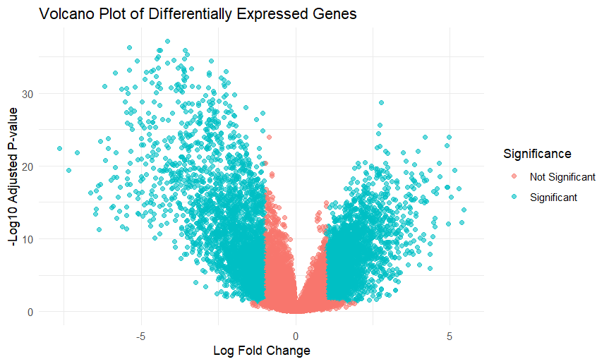

# Breast Cancer Gene Expression Analysis Using Bioinformatics

## 1. Title and Abstract

### Title
**Breast Cancer Gene Expression Analysis Using the GSE42568 Dataset: Identification of Differentially Expressed Genes**

### Abstract

Breast cancer is one of the most common cancers affecting women worldwide. Understanding gene expression differences between cancerous and normal breast tissues can help researchers identify genes associated with cancer development. This project investigates breast cancer gene expression using the publicly available GSE42568 dataset from the Gene Expression Omnibus (GEO) database. R programming and bioinformatics techniques are used to perform exploratory data analysis, Principal Component Analysis (PCA), differential gene expression analysis, and hierarchical clustering. The limma package is applied to identify significantly differentially expressed genes between cancer and normal samples. Results are visualized using sample distribution plots, PCA plots, volcano plots, and heatmaps. The study aims to explore gene expression patterns and identify potential molecular markers associated with breast cancer.

## 2. Introduction

### 2.1 Background

Breast cancer is a major global health problem and one of the leading causes of cancer-related illness among women. It develops when abnormal cells in breast tissue grow uncontrollably.

Gene expression analysis is an important bioinformatics technique used to understand differences in gene activity between healthy and diseased tissues.

By comparing gene expression levels in normal and cancerous breast tissues, researchers can identify genes that may be associated with breast cancer development and progression.

### 2.2 Problem Statement

Identifying genes that show significant expression differences between normal and cancerous breast tissues is an important challenge in bioinformatics.

Analyzing large-scale gene expression datasets manually is difficult because they contain measurements for thousands of genes across multiple biological samples.

Therefore, computational and statistical methods are needed to identify meaningful gene expression patterns efficiently.

### 2.3 Aim

The main aim of this project is to analyze breast cancer gene expression data and identify differentially expressed genes between cancer and normal breast tissue samples using bioinformatics techniques in R.

### 2.4 Objectives

1. Obtain breast cancer gene expression data from the GEO database.
2. Explore and prepare the gene expression dataset.
3. Investigate sample distributions and gene expression patterns.
4. Apply PCA to explore similarities and differences between samples.
5. Identify differentially expressed genes using the limma package.
6. Visualize significant gene expression differences using volcano plots and heatmaps.

### 2.5 Research Hypothesis

**H0 (Null Hypothesis):** There is no significant difference in gene expression between breast cancer and normal breast tissue samples.

**H1 (Alternative Hypothesis):** There are significant differences in the expression of some genes between breast cancer and normal breast tissue samples.

## 3. Data Description

### 3.1 Dataset Source

The dataset used in this project is obtained from the Gene Expression Omnibus (GEO), a public repository maintained by the National Center for Biotechnology Information (NCBI).

- **Dataset ID:** GSE42568
- **Database:** Gene Expression Omnibus (GEO)
- **Organization:** National Center for Biotechnology Information (NCBI)
- **Organism:** Homo sapiens (Human)
- **Data Type:** Gene expression profiling
- **Dataset URL:** https://www.ncbi.nlm.nih.gov/geo/query/acc.cgi?acc=GSE42568
- **Download Format:** Compressed GEO series matrix file (.txt.gz)

### 3.2 Dataset Description

The GSE42568 dataset contains gene expression measurements from human breast tissue samples.

The dataset includes expression measurements and associated sample metadata.

The expression matrix contains:
- Rows representing genes or probe identifiers.
- Columns representing biological samples.
- Values representing gene expression measurements.

Sample metadata provides information such as sample titles and characteristics, which are used to identify cancer and normal sample groups.

### 3.3 Variables Used

| Variable | Description |
|---|---|
| Expression Data | Gene expression measurements |
| Sample Titles | Sample identification and descriptions |
| Group | Sample classification (Cancer or Normal) |
| logFC | Logarithmic fold change in gene expression |
| P-value | Statistical significance measure |
| adj.P.Val | Multiple-testing adjusted p-value |

### 3.4 Ethical and Licensing Considerations

This project uses publicly available gene expression data obtained from the NCBI GEO database.

No new human participants were recruited, and no personal identifying information was collected for this analysis.

The original dataset and associated study remain subject to their original publication and data-use conditions. Appropriate acknowledgement of the dataset source is provided.

## 4. Methods

### 4.1 Analysis Workflow

The analysis follows these main stages:

1. Dataset collection from NCBI GEO.
2. Data loading and sample metadata extraction.
3. Data cleaning and preprocessing.
4. Exploratory Data Analysis (EDA).
5. Principal Component Analysis (PCA).
6. Differential Gene Expression Analysis.
7. Volcano plot visualization.
8. Hierarchical clustering and heatmap generation.

### 4.2 Programming Language and Packages

The analysis is performed using R programming language.

The following packages are used:

| Package | Purpose |
|---|---|
| GEOquery | Downloading and loading GEO datasets |
| limma | Differential gene expression analysis |
| ggplot2 | Creating statistical visualizations |
| tidyverse | Data manipulation and filtering |
| pheatmap | Generating gene expression heatmaps |

### 4.3 Data Collection and Preparation

The GSE42568 dataset is downloaded from NCBI GEO using the `download.file()` function.

The GEOquery package is used to load the expression matrix and sample metadata.

Sample groups are identified using sample titles and classified into:

- Normal
- Cancer

The dataset is checked for missing values and duplicated sample names.

Genes with zero variance are identified and removed from the dataset used for PCA.

### 4.4 Exploratory Data Analysis

Exploratory Data Analysis is performed to understand the structure and characteristics of the dataset.

The following analyses are conducted:

- Sample distribution analysis.
- Gene expression distribution analysis.
- Dataset dimension checking.
- Missing-value analysis.
- Gene variance analysis.

A bar chart is used to visualize the distribution of cancer and normal samples. A boxplot is used to explore gene expression distributions.

### 4.5 Principal Component Analysis

Principal Component Analysis (PCA) is applied to explore patterns and similarities between samples.

The PCA technique transforms high-dimensional gene expression measurements into a smaller number of principal components.

The first two principal components are visualized using a scatter plot to investigate whether cancer and normal samples show different expression patterns.

### 4.6 Differential Gene Expression Analysis

The limma package is used to identify genes with significantly different expression levels between cancer and normal samples.

The analysis includes:

1. Creating a design matrix.
2. Fitting a linear model using `lmFit()`.
3. Defining the comparison using `makeContrasts()`.
4. Applying contrasts using `contrasts.fit()`.
5. Applying empirical Bayes moderation using `eBayes()`.
6. Extracting results using `topTable()`.

The Benjamini-Hochberg (BH) method is used to adjust p-values and control the false discovery rate.

The following thresholds are used to identify significant genes:

- Adjusted p-value < 0.05
- Absolute log fold change > 1

### 4.7 Volcano Plot

A volcano plot is generated using ggplot2 to visualize differential gene expression results.

The x-axis represents log fold change, while the y-axis represents the negative logarithm of the adjusted p-value.

Significant and non-significant genes are distinguished using different colors.

### 4.8 Hierarchical Clustering and Heatmap

Gene expression variance is calculated to identify highly variable genes.

The top 30 genes with the highest expression variance are selected for heatmap visualization.

The pheatmap package is used to generate a heatmap with row scaling and sample group annotations.

This visualization helps explore gene expression patterns and clustering relationships among samples.

## 5. Results

The following visualizations and statistical outputs are generated through the analysis.

### 5.1 Sample Distribution

**Figure 1: Distribution of Cancer and Normal Samples**


This bar chart illustrates the number of samples belonging to each group.

### 5.2 Gene Expression Distribution

**Figure 2: Gene Expression Distribution**


The boxplot illustrates the distribution of gene expression measurements across the first ten samples.

### 5.3 Principal Component Analysis

**Figure 3: PCA of Breast Cancer Samples**


The PCA plot visualizes sample relationships based on the first two principal components.

### 5.4 Differential Gene Expression

The differential expression analysis identifies genes showing differences between cancer and normal tissue samples.

The significance criteria are:

- Adjusted p-value < 0.05
- Absolute log fold change > 1

The significant gene results are saved in:

`results/tables/significant_genes.csv`

**Number of significant genes:** To be updated after running the analysis.

### 5.5 Volcano Plot

**Figure 4: Volcano Plot of Differentially Expressed Genes**



The volcano plot illustrates the relationship between gene expression changes and statistical significance.

### 5.6 Gene Expression Heatmap

**Figure 5: Heatmap of the Top 30 Highly Variable Genes**


The heatmap displays the expression patterns of the top 30 highly variable genes across cancer and normal samples.

### 5.7 Summary of Results

The analysis produces the following outputs:

| Analysis | Output |
|---|---|
| Sample distribution | Bar chart |
| Expression distribution | Boxplot |
| PCA | PCA scatter plot |
| Differential expression | Significant gene table |
| Gene expression changes | Volcano plot |
| Clustering | Heatmap |

*Note: Actual statistical values, sample counts, and significant gene counts should be added after executing the complete analysis.*

## 6. Discussion

This project investigates differences in gene expression between breast cancer and normal breast tissue samples using statistical and visualization techniques.

Exploratory Data Analysis provides an overview of sample distribution and gene expression characteristics.

PCA helps investigate similarities and differences among biological samples based on their gene expression profiles.

Differential gene expression analysis using limma identifies genes that may be associated with breast cancer. The volcano plot provides a visual representation of the magnitude and statistical significance of gene expression changes.

The heatmap provides additional insight into expression patterns among the top highly variable genes.

### 6.1 Limitations

The project has several limitations:

1. The analysis uses a single publicly available dataset.
2. Sample classification depends on the accuracy of the GEO sample metadata.
3. Statistical significance does not necessarily indicate biological importance.
4. The analysis does not independently validate the identified genes using another dataset.
5. The top 30 variable genes are selected based on variance rather than biological relevance.

### 6.2 Real-World Implications

Identifying genes associated with breast cancer may support further research into disease mechanisms, potential biomarkers, and molecular characteristics of breast cancer.

However, the results of this computational analysis are exploratory and should not be considered a clinical diagnostic method.

## 7. Conclusion and Future Work

### 7.1 Conclusion

This project demonstrates the use of bioinformatics techniques to analyze breast cancer gene expression data.

Using the GSE42568 dataset, the analysis explores gene expression patterns, investigates sample relationships through PCA, and identifies differentially expressed genes using the limma package.

Volcano plots and heatmaps provide visual representations of the analysis results.

Overall, the project demonstrates how R programming and statistical bioinformatics methods can be used to investigate gene expression differences between cancer and normal tissue samples.

### 7.2 Future Work

Possible future improvements include:

1. Performing Gene Ontology (GO) enrichment analysis.
2. Conducting KEGG pathway analysis.
3. Validating significant genes using independent breast cancer datasets.
4. Applying machine learning techniques to classify cancer and normal samples.
5. Investigating the biological functions of identified significant genes.

## 8. Reproducibility

### 8.1 Project Structure

```text
Breast-Cancer-Bioinformatics/
│
├── data/
│   └── GSE42568_series_matrix.txt.gz
│
├── code/
│   └── analysis.R
│
├── results/
│   ├── figures/
│   └── tables/
│       └── significant_genes.csv
│
├── README.md
│
└── Breast-Cancer-Analysis.Rmd
```

### 8.2 Requirements

The project requires:

- R programming language
- RStudio
- Internet connection for the initial dataset download

### 8.3 Package Installation

Install the required CRAN packages:

```r
install.packages(c(
  "ggplot2",
  "tidyverse",
  "pheatmap"
))
```

Install Bioconductor packages:

```r
if (!requireNamespace("BiocManager", quietly = TRUE)) {
  install.packages("BiocManager")
}

BiocManager::install(c(
  "GEOquery",
  "limma"
))
```

### 8.4 Running the Project

1. Clone or download the GitHub repository.
2. Open the project folder in RStudio.
3. Install the required packages.
4. Run `code/analysis.R` or open `Breast-Cancer-Analysis.Rmd`.
5. Download the GEO dataset if it is not already available locally.
6. Execute the analysis.
7. Review the generated plots and statistical results.

### 8.5 R and Package Versions

The R version and package versions can be checked using:

```r
R.version.string

packageVersion("GEOquery")
packageVersion("limma")
packageVersion("ggplot2")
packageVersion("tidyverse")
packageVersion("pheatmap")
```

For reproducibility, record the versions used when performing the final analysis.

## 9. References

1. Edgar, R., Domrachev, M., & Lash, A. E. (2002). Gene Expression Omnibus: NCBI gene expression and hybridization array data repository. *Nucleic Acids Research, 30*(1), 207–210. https://doi.org/10.1093/nar/30.1.207

2. Ritchie, M. E., Phipson, B., Wu, D., Hu, Y., Law, C. W., Shi, W., & Smyth, G. K. (2015). limma powers differential expression analyses for RNA-sequencing and microarray studies. *Nucleic Acids Research, 43*(7), e47. https://doi.org/10.1093/nar/gkv007

3. Davis, S., & Meltzer, P. S. (2007). GEOquery: A bridge between the Gene Expression Omnibus (GEO) and BioConductor. *Bioinformatics, 23*(14), 1846–1847. https://doi.org/10.1093/bioinformatics/btm254

4. Wickham, H. (2016). *ggplot2: Elegant Graphics for Data Analysis*. Springer. https://doi.org/10.1007/978-3-319-24277-4

5. Kolde, R. (2019). *pheatmap: Pretty Heatmaps*. R package. https://CRAN.R-project.org/package=pheatmap

6. R Core Team. *R: A Language and Environment for Statistical Computing*. R Foundation for Statistical Computing. https://www.R-project.org/

7. National Center for Biotechnology Information. *Gene Expression Omnibus: GSE42568*. https://www.ncbi.nlm.nih.gov/geo/query/acc.cgi?acc=GSE42568

---

**Project developed for academic bioinformatics research and learning purposes.**